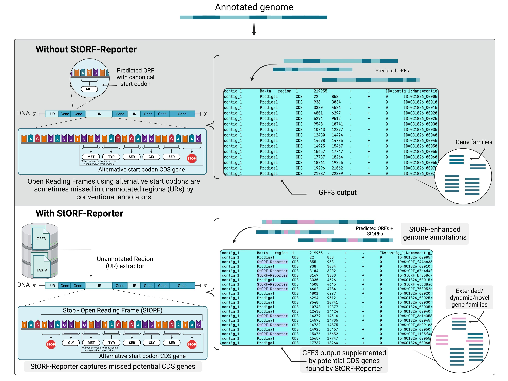

# StORF-Reporter

StORF-Reporter discovers and prioritises stop-to-stop open reading frame
(StORF) candidates in unannotated regions of prokaryotic genomes. It augments
an existing annotation without replacing the original gene caller.

> **v2 release:** predictions are candidates, not automatically
> proven genes. Unpromoted candidates use the Sequence Ontology-compatible
> `ORF` type. The default high-tier policy changes structurally valid candidates
> to `CDS`; use `--promote-cds` to select another tier or `--no-promote-cds` to
> retain every feature as `ORF`/`StORF`. Promotion changes the feature type, not
> the reported stop-derived locus.

[](https://github.com/NickJD/StORF-Reporter/actions/workflows/ci.yml)
[](https://doi.org/10.1093/nar/gkad814)
[](LICENSE)



## Install

The release can be installed from a checkout:

```bash
python -m pip install .
storf install-check
```

Python 3.9 or newer is required. Pyrodigal is installed for de novo annotation
mode; NumPy is no longer a runtime dependency.

Commands can also be run directly from an unpacked source tree without an
editable install or `PYTHONPATH`:

```bash
cd src/StORF_Reporter
python cli.py --help
python StORF_Finder.py --help
```

Installed console commands, `python -m StORF_Reporter.cli`, and these direct
source-script forms all use the same package implementation.

## Ten-minute workflow

Run the self-contained example:

```bash
storf augment \
  --input examples/quickstart/genome.gff3 \
  --fasta examples/quickstart/genome.fna \
  --outdir quickstart-results \
  --overlap-mode none
```

The sample output directory contains:

- a validated augmented GFF3;
- unannotated-region GFF3 and FASTA files;
- nucleotide and amino-acid candidate FASTA files;
- a TSV explaining every evidence-score component;
- an HTML candidate-review report;
- a validation JSON report; and
- a JSON run manifest with parameters, input hashes, counts, and provenance.

`augment` always validates each GFF3/FASTA pair before analysis and validates
the generated annotation again before reporting success. Input errors stop the
sample before analysis; non-fatal warnings are shown on standard error.

Validate an output independently:

```bash
storf validate \
  --gff quickstart-results/genome/genome_StORF-Reporter.gff \
  --fasta examples/quickstart/genome.fna
```

## Main commands

```text
storf augment       augment GFF3 annotations, files, directories, or manifests
storf find          search ordinary FASTA sequences
storf extract-urs   write unannotated-region GFF3 and FASTA
storf extract       extract reported candidate sequences
storf filter        retain candidates with BLAST/DIAMOND evidence
storf validate      validate format/coordinates and StORF CDS structure
storf install-check report runtime and installed-command health
storf citation      print the preferred citation
```

Run `storf COMMAND --help` for all options.

The three installed auxiliary commands are `storf-add` (coordinate-aware GFF3
merge), `storf-uncovered` (sequence left outside selected annotations and
reported StORFs), and `storf-lengths` (FASTA length statistics).

### Batch directories

```bash
storf augment --input bakta-results/ --recursive --outdir results/
```

`--input` accepts one GFF3, one combined GFF3 containing a `##FASTA`
section, or a directory of samples. Supply `--fasta` only when processing one
separate GFF3/FASTA pair. Use a manifest when annotation and sequence files do
not share a stem or are stored in different directories.

Pairing is deterministic. A matching stem is preferred; ambiguous FASTA
pairings fail with an actionable error instead of silently selecting a file.
Use `--profile prokka`, `--profile bakta`, `--profile ensembl`, or
`--profile cds-only` to select an annotated-region policy. `--gene-ident`
overrides the profile and restores the original selector syntax:

```bash
# Exact, case-sensitive feature types
storf augment ... --gene-ident CDS,rRNA,tRNA

# The historical broad Prokka/Bakta feature list
storf augment ... --gene-ident Prokka

# Match the GFF3 attribute ID=gene... regardless of feature type
storf augment ... --gene-ident ID=gene
```

The default selector is `CDS`. The `ensembl` profile maps to `ID=gene`, so
`gene`, `ncRNA_gene`, `rRNA_gene`, `tRNA_gene`, and `pseudogene` records whose
IDs begin with `gene` all occupy annotated sequence. `--exclude-types` remains
as a compatibility alias for exact comma-separated feature types.

### Sample manifests

```tsv
sample	gff	fasta
isolate_1	annotations/isolate_1.gff3	genomes/isolate_1.fna
isolate_2	annotations/isolate_2.gff3	genomes/isolate_2.fna
```

```bash
storf augment --manifest samples.tsv --outdir results/
```

### Evidence tiers and CDS promotion

Evidence scores combine candidate length, an in-frame start codon, a simple
Shine–Dalgarno motif search, ambiguous-base burden, UR-core coverage, and any
user-supplied external evidence. They are transparent prioritisation
heuristics, **not calibrated probabilities**.

```bash
# Keep every retained candidate as ORF/StORF
storf augment --input annotation.gff3 --fasta genome.fna --no-promote-cds

# Produce a mixed GFF3: promote structurally valid high-tier calls to CDS and
# retain all other calls as ORF/StORF (the default promotion threshold)
storf augment --input annotation.gff3 --fasta genome.fna --promote-cds high
```

CDS promotion requires all of the following under the selected genetic code:

- a supported in-frame start codon;
- a length divisible by three and adequate for the selected StORF size class;
- a valid terminal stop codon;
- no internal in-frame stop codon; and
- no ambiguous nucleotide in the proposed coding sequence.

These are structural checks, not proof that a candidate is expressed or
functional. Con-StORFs contain one or more expected middle stops and are
readthrough candidates, not conventional complete CDS features. They are never
automatically promoted by either `augment` or homology filtering.

Start selection evaluates every supported in-frame start that leaves an
adequate coding length. It ranks local Shine–Dalgarno-like motif support and
spacing, start-codon strength, and retained coding length; it does not simply
take the first start. The search can use sequence immediately before the
stop-to-stop boundary. For Con-StORFs, only starts before the first middle stop
are eligible.

Use `--evidence-tsv` to add 0–1 homology, proteomics, transcriptomics, or other
evidence values keyed by stable candidate ID.

### Con-StORF replacement semantics

`--include-consecutive` enables maximal Con-StORFs formed from runs of at least
two adjacent qualifying ordinary StORFs. A run may contain one or several
middle in-frame stops. Con-StORFs and ordinary StORFs then enter the same
overlap ranking, so this option is not a promise to add Con-StORFs to an
otherwise unchanged result: a stronger Con-StORF can take over and replace
overlapping ordinary StORFs. Use `--consecutive-only` when only the maximal
multi-stop candidates are wanted.

`CandidateValidationPolicy=con-storf-readthrough-v1` passes only when the
selected start is before the first middle stop and the first translated segment
meets the size-class minimum. `MiddleStopCount`, `MiddleStops`, and
`MiddleStopCoordinates` make the expected internal stops explicit. Passing
this structural candidate check does not demonstrate biological stop-codon
readthrough.

### GFF3 coordinates and overlap coordinates

Every retained call remains a stop-delimited StORF candidate. The literal full
stop-to-stop interval is preserved in `CandidateCoordinates`. Following the
historical `-spos False` convention, default GFF3 columns 4–5 and candidate
nucleotide FASTA omit the upstream delimiting stop codon (three nucleotides)
but retain the rest of that stop-derived locus. Use `--include-first-stop` to
include that codon and display the literal full interval. Select
`--gff-coordinate-mode start-to-stop` to put the ranked start through terminal
stop in columns 4–5 when a supported start exists. Promotion changes column 3
to `CDS` but does not independently change columns 4–5. `CodingCoordinates`
continues to identify the structurally validated coding sequence.

Every record retains both `CandidateCoordinates` and `CodingCoordinates`, plus
the unambiguous `CandidateLength` and `CodingLength` attributes.
Candidate-candidate overlap is measured on ranked coding intervals by default,
preventing long non-coding prefixes from suppressing compatible ORFs. Use
`--overlap-coordinate-basis candidate` for historical full stop-to-stop overlap
filtering.

### Primary annotation versus lower-tier review calls

Reported StORFs are inserted into the augmented GFF3 beside neighbouring
features on the same contig, ordered by genomic coordinate. They are no longer
appended as one block after all original annotations.

By default, `--primary-tier exploratory` keeps every retained candidate in the
primary augmented GFF3 and its `_StORFs.fasta`, `_StORFs_aa.fasta`, and
`_StORFs.tsv` files. To make the primary annotation more conservative:

```bash
# Primary GFF/FASTA/TSV: high tier only.
# Medium and exploratory calls: separate below-high review files.
storf augment \
  --input annotation.gff3 \
  --fasta genome.fna \
  --primary-tier high \
  --promote-cds high
```

`--primary-tier medium` includes high and medium candidates in the primary
outputs and places exploratory candidates in files such as
`sample_StORFs_below-medium.gff` and
`sample_StORFs_below-medium.fasta`. Lower-tier candidates are preserved rather
than silently discarded. The HTML report still lists every retained candidate
and identifies its destination.

### Independent BLAST/DIAMOND evidence filtering

The protein FASTA produced by `augment` can be searched against a curated or
taxonomically appropriate known-protein database. Standard BLAST/DIAMOND
format 6 (the normal 12 columns) can then be applied independently:

```bash
storf filter \
  --gff results/sample/sample_StORF-Reporter.gff \
  --fasta genome.fna \
  --alignments known-protein-hits.tsv \
  --min-bitscore 50 \
  --max-evalue 1e-10 \
  --min-identity 30 \
  --min-alignment-length 30 \
  --keep-unmatched \
  --promote-cds \
  --out sample_homology-reviewed.gff

storf validate --gff sample_homology-reviewed.gff --fasta genome.fna
```

With `--keep-unmatched`, candidates lacking qualifying hits remain at their
existing type, so the result can contain both `ORF`/`StORF` and `CDS`
features. Without it, unsupported StORFs are removed. `--promote-cds` requires
the matching FASTA (unless embedded), rechecks the proposed coding sequence,
and promotes only structurally valid hits. Homology is supporting evidence; it
does not by itself experimentally confirm translation or function.

Historical StORF FASTA query names containing semicolon-suffixed attributes are
normalized to the corresponding GFF3 `ID`, so old BLAST format-6 files remain
usable.

### Sequence extraction coordinates

`augment`, `find`, and `extract` default to the same stop-derived candidate
locus for both nucleotide and amino-acid FASTA, omitting the upstream
delimiting stop. Amino-acid output is therefore a translation of the reported
candidate locus, even when column 3 is `CDS`; promotion never silently switches
FASTA to `CodingCoordinates`. Use `--protein-coordinate-mode coding` during
discovery or `storf extract --sequence-region coding` afterward only when a
ranked coding-sequence FASTA is explicitly wanted. In discovery output,
candidates without `CodingCoordinates` remain candidate-locus records rather
than being dropped. `--include-first-stop`
retains the upstream stop in candidate-locus output.
This is independent of whether the displayed GFF3 interval is stop-to-stop,
start-to-stop, or a promoted CDS. Use `--sequence-region candidate`, `coding`,
or `feature` only when an explicit alternative representation is required.

Con-StORF protein records preserve internal `*` symbols by default so expected
middle stops remain visible. `--remove-inframe-stops` removes those symbols
from protein FASTA only; it never edits nucleotide sequence or genomic
coordinates. Historical commands retain the equivalent `-rs` control.

### Alternative genetic codes

Translation tables 1, 4, and 11 are supported. Code 4 correctly treats `TGA`
as tryptophan rather than a stop:

```bash
storf augment --input mycoplasma.gff3 --fasta mycoplasma.fna --genetic-code 4
```

## Legacy commands

`StORF-Reporter`, `StORF-Finder`, `UR-Extractor`, `StORF-Extractor`, and
`StORF-Remover` remain installed. They now call the same v2 core and use safe
Boolean parsing. See [RELEASE_2.0.0.md](RELEASE_2.0.0.md) for deliberate
compatibility changes.

## Scientific interpretation

StORF-Reporter enumerates biologically interesting candidates that conventional
annotation may miss. A stop-to-stop ORF is not by itself proof of a gene.
High-value follow-up includes conservation, protein homology, coding-potential,
Ribo-seq, transcriptomics, or proteomics evidence. The evidence TSV and HTML
report are designed to make that review explicit.

## Publication and citation

Dimonaco NJ, Aubrey W, Kenobi K, Clare A. StORF-Reporter: finding genes missed
by gene finders. *Nucleic Acids Research*. 2023;51(21):11504–11517.
[doi:10.1093/nar/gkad814](https://doi.org/10.1093/nar/gkad814)

Machine-readable citation metadata is in [CITATION.cff](CITATION.cff).

## Development

```bash
python -m pip install -e '.[dev]'
ruff check src tests
pytest -q
python -m build
```

See [CONTRIBUTING.md](CONTRIBUTING.md) and the complete
[v2 release notes](RELEASE_2.0.0.md).

To execute and inspect every unified, legacy, Pyrodigal, and auxiliary subtool
against the bundled datasets, use
[docs/SUBTOOL_INSPECTION_RUNS.md](docs/SUBTOOL_INSPECTION_RUNS.md) and
`examples/run_all_subtools.sh`.

Scientific interpretation and v1 migration guidance are in
[docs/SCIENTIFIC_INTERPRETATION.md](docs/SCIENTIFIC_INTERPRETATION.md) and
[docs/MIGRATION_V2.md](docs/MIGRATION_V2.md).
